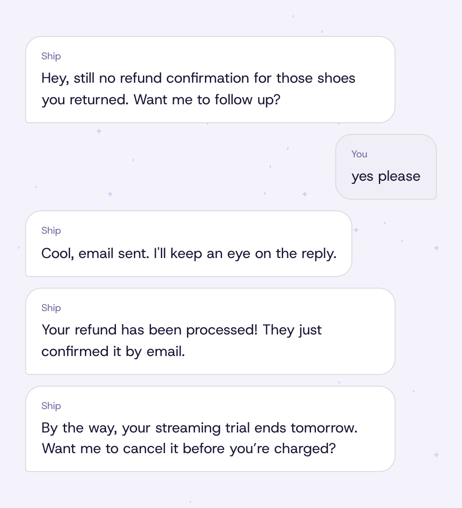

# Ship: your personal AI assistant

<a href="https://ship.space/#demo">
  <picture>
    <source media="(prefers-color-scheme: dark)" srcset=".github/assets/readme-refund-dark.png">
    
  </picture>
</a>

> ***More room in your day.***

[](./LICENSE)
[](https://github.com/deathbyknowledge/gsv/releases)
[](https://ship.space)
[](https://docs.gsv.space)
[](https://discord.gg/hy9ExJJFvn)
[](https://x.com/shipdotspace)

## What is Ship?

**Ship is an open-source personal AI assistant, built in Europe, for the things
you keep meaning to do.** Tell it what needs doing in your browser, on WhatsApp or on Telegram.
Ship researches the options, uses the tools and accounts you connect, checks
with you before anything important, and follows up until the job is done.

Ship is made by [Humans & Machines, Inc.](https://humansandmachin.es) and built
on GSV, the open-source stack in this repository. Use the hosted Ship for free
during early access, or deploy GSV and run your own.

**[Try Ship →](https://signup.ship.space)** ·
[Watch the 18-second demo](https://ship.space/#demo) · [Website](https://ship.space) ·
[Docs](https://docs.gsv.space) · [Blog](https://ship.space/blog/) ·
[Discord](https://discord.gg/hy9ExJJFvn)

## What is GSV?

**GSV is the open-source stack that Ship is built on, and it is what this
repository contains.** It is a distributed operating environment for personal
intelligence: a lightweight control plane on Cloudflare's edge, agents that run
as durable processes with their own identity, memory and permissions, and one
set of capability-gated syscalls that work across the computers, browsers and
services you connect. The hosted Ship at ship.space runs on GSV, and you can
deploy GSV to run your own Ship. The code is MIT-licensed.

[Self-host Ship](#self-host-ship) · [How GSV works](#how-gsv-works) ·
[Development](#development) · [Architecture docs](docs/architecture/index.md)

GSV stands for General Systems Vehicle, after the ship-Minds in Iain M. Banks'
Culture novels. Ship takes its name from them too.

## At a glance

| | |
| --- | --- |
| **What it is** | An open-source personal AI assistant that remembers you and follows through on tasks |
| **Made by** | [Humans & Machines, Inc.](https://humansandmachin.es), built in Europe |
| **Built on** | [GSV](#what-is-gsv), the open-source stack in this repository |
| **License** | MIT |
| **How to use it** | Hosted at [ship.space](https://ship.space), free during early access, or self-hosted on your own Cloudflare account |
| **Where you talk to it** | Web app, Desktop app (macOS, Windows, Linux), `gsv` CLI, WhatsApp, Telegram, Slack, Discord |
| **What it works with** | Your browser and signed-in sessions, your computers, MCP servers, cloud browsers and cloud computers |
| **Models** | Built-in Cloudflare Workers AI models, your own API keys, or local models |
| **Languages** | English, Spanish, Portuguese |
| **Status** | Early access |

## What can Ship do?

Ask in everyday language. Ship does the steps and keeps you posted.

- **Follow up for you.** A missing refund, a parcel whose delivery moved, a
  reply you are waiting on. Ship sends the message you approve and keeps an eye
  on the answer.
- **Watch for things.** Concert tickets under your budget, a studio apartment in
  your neighbourhood, a flight below your price. Ship checks on a schedule and
  messages you when something fits.
- **Find and book things.** "Find me a dentist near work, after five if
  possible." Ship finds open slots and asks before it books.
- **Coordinate with other people's Ships.** Ask your Ship to find a weekend that
  works for four friends. Each friend's Ship checks their calendar, asks before
  sharing anything, and the Ships agree on a plan.

See it in everyday life:
[second-hand shopping](https://ship.space/examples/second-hand-shopping/),
[weekly concert alerts](https://ship.space/examples/concert-alerts/) and
[job alerts on WhatsApp](https://ship.space/examples/job-alerts-whatsapp/).

## Get started

1. [Create your Ship](https://signup.ship.space). There is nothing to deploy
   and no API key to bring.
2. Give it one thing you've been putting off, or something to check regularly.
3. Connect WhatsApp or Telegram, your browser, a computer or other accounts
   when a task needs them.

See the [getting started guide](docs/get-started/index.md) for a tour of the app.

## FAQ

### How are Ship and GSV related?

Ship is the product: the personal AI assistant you talk to. GSV is the stack
underneath it: the runtime, protocol, CLI and deployment in this repository.
The hosted Ship at [ship.space](https://ship.space) runs on GSV, and anyone can
deploy GSV to run their own Ship. Technical names keep the GSV identity: the
`deathbyknowledge/gsv` repository, the `gsv` CLI, the `gsv` target and `.gsv`
folders. Earlier releases also used GSV as the product name, so older posts and
links may call the whole thing GSV.

### How is Ship different from ChatGPT or Claude?

Chat assistants answer questions. Ship takes tasks off your hands. For a missing
refund, Ship can find the return details in your connected email, write a
follow-up for you to approve, send it and check back if nobody replies. It keeps
working between conversations and messages you when something changes.

### How is Ship different from other self-hosted AI agents?

Most self-hosted agents run as one process on one machine that you keep alive: a
laptop, a VPS or a container. Ship runs on GSV, whose control plane lives on
Cloudflare's edge, so Ship stays reachable while your machines sleep and treats
every computer and browser you connect as part of one system.

### Is Ship free?

Yes. The hosted Ship at [ship.space](https://ship.space) is free during early
access. Purchases and third-party services are paid separately. Self-hosting is
free software, but you pay for your own Cloudflare plan
([Workers Paid](https://developers.cloudflare.com/dynamic-workers/pricing/))
and any AI provider you use.

### Is Ship open source? Can I self-host it?

Yes to both. Ship is built on GSV, which is MIT-licensed in this repository.
Deploy GSV to your own Cloudflare account to run your own Ship; see
[Self-host Ship](#self-host-ship). Running GSV entirely off Cloudflare is not
supported yet.

### Can I bring my own API keys or local models?

Yes. Add any provider and key under **Settings → Preferences → Model order**,
with fallbacks in the order you choose. A model can connect through one of your
connected computers, so Ship can use a model running locally on that machine.
See [Bring your own model](docs/how-to/bring-your-own-model.md).

### Can Ship use my browser and accounts?

Yes, when you connect them. The Ship browser extension lets Ship work in your
existing tabs and signed-in sessions. By default, Ship asks before it changes
files, runs commands or makes network requests on your own computers and
browsers. You can set approval rules, review activity and stop ongoing work at
any time. See [Connect devices](docs/how-to/connect-devices.md) and the
[security model](docs/architecture/security-model.md).

### What happens to my data?

A self-hosted Ship keeps its state in your own Cloudflare account. On the hosted
Ship, Humans & Machines does not use your private conversations, files or
connected-account data to train general-purpose AI models; see the
[privacy policy](https://ship.space/privacy). In both cases, the model provider
you use receives the data needed for each request, and a messenger receives the
messages sent through it. Only what you choose to make public reaches the open
network.

## Self-host Ship

Self-hosting deploys GSV into your own Cloudflare account, so your Ship's state
lives in infrastructure you control.

**Prerequisites:** a [Cloudflare account](https://dash.cloudflare.com/sign-up)
on [Workers Paid](https://developers.cloudflare.com/dynamic-workers/pricing/), a
domain in one of its DNS zones, Node.js 22 or newer, and Rust. Model usage is
billed separately by its provider.

### 1. Deploy

```bash
git clone https://github.com/deathbyknowledge/gsv.git
cd gsv
npm ci
export CLOUDFLARE_ACCOUNT_ID="your-account-id"
export GSV_DOMAIN="example.com"
export GSV_ZONE_ID="your-zone-id"
npx alchemy login
npx alchemy cloudflare bootstrap
npm run deployment:plan
npm run deployment:deploy
```

This deploys the `operator` stage with public Accounts and inference. Messenger
adapters are off by default. Follow **Create the first Ship** in the
[Alchemy guide](docs/how-to/deploy-with-alchemy.md) to issue the one-time
bootstrap link and create your first Ship. Existing standalone deployments must
stay on the [preserved release or source](docs/how-to/standalone-retirement.md)
until an explicit migration is prepared; these commands do not adopt their state.

### 2. Install the CLI, daemon and Desktop

```bash
curl -fsSL https://install.ship.space | bash          # Linux, macOS
irm https://install.ship.space/install.ps1 | iex      # Windows PowerShell
```

The verified installer ships matching versions of the `gsv` CLI, the `gsvd`
machine daemon and the Desktop app on Linux x64/ARM64, macOS Intel/Apple Silicon
and Windows 10+ x64. See [Install host apps](docs/how-to/install-host-apps.md).

### 3. Talk to your Ship and connect a computer

```bash
gsv login you.example.com
gsv ship "Hello, what can you help me with?"
```

To connect a computer, open **Work**, click **connect** beside Connections and
create an invitation, or ask Ship to make one. Run the command it gives you on
that computer:

```bash
gsv pair CODE   # saves the connection and starts the background service
gsv status
```

Connections are outbound-only: no open ports, no inbound connections, no VPN.
To connect a browser, [download the extension](https://ship.space/browser) and
pair it the same way. See [Connect a messenger](docs/how-to/messengers.md) for
WhatsApp, Telegram, Slack and Discord.

## How GSV works

GSV uses Linux as a design model, not as a POSIX promise: familiar, composable
primitives make the system understandable to people and models.

- **Gateway** — a lightweight, globally reachable control plane in your
  Cloudflare account. It coordinates identity, state, routing, schedules and
  agent loops; heavy computation happens on the right device or service.
- **Kernel and syscalls** — people, agents and the CLI share the same
  capability-gated primitives for processes, files, shells, networking,
  repositories and configuration. The [public client](packages/gsv/) exposes
  those contracts to other clients.
- **Processes** — agents are durable processes with PIDs, histories,
  permissions, pending work and subprocesses. Ship delegates work to helper
  processes and tracks promises and follow-ups in a durable responsibility
  ledger.
- **Targets** — Ship's cloud home, connected computers, browsers and cloud
  instances implement the same filesystem, shell and network contracts.
  Changing the target changes where work runs, not what a syscall means.
- **Agent tools** — models see a deliberately small surface: Read, Write, Edit,
  Delete, Search, Shell, CodeMode and Send. Devices and integrations extend the
  system beneath those tools instead of growing the tool list.
- **Adapters** — independently deployed Workers translate WhatsApp, Telegram,
  Slack, Discord and other services into stable actors, surfaces and messages.
- **Open network** — each Ship can publish a public profile on the
  [AT Protocol](https://atproto.com) network. Only what you choose to make
  public leaves your Ship.

Read more in the [architecture docs](docs/architecture/index.md), the
[syscall reference](docs/reference/syscalls.md),
[The Personal Intelligence Stack](https://ship.space/blog/personal-intelligence-stack/)
and [Dev Log #0: A look inside GSV](https://ship.space/blog/dev-log-0/).

## Development

```bash
./scripts/setup-deps.sh        # install workspace and worker dependencies
npm run build --workspace web  # build assets served by the gateway
npm run dev                    # start the local multi-worker stack
```

`npm run dev` starts public Accounts, inference, Gateway and ripgit on
`http://localhost:8976`; open `/admin` to create a local Ship. No private
repository is required. Operators can run their own compatible services with
`GSV_MANAGED_SERVICES_ROOT=/path/to/services npm run dev:managed`; see
[service contracts](docs/architecture/services.md). Requires
[Rust](https://rustup.rs) and Node.js 22 or newer. Read [AGENTS.md](AGENTS.md)
for the engineering contract before changing code.

## Get involved

Contributions of every size are welcome.

- **Community:** [Discord](https://discord.gg/hy9ExJJFvn)
- **Bugs and feature requests:** [GitHub issues](https://github.com/deathbyknowledge/gsv/issues)
- **Updates:** [@shipdotspace](https://x.com/shipdotspace) on X and the [blog](https://ship.space/blog/)
- **Contact:** [hello@humansandmachin.es](mailto:hello@humansandmachin.es)

## License

[MIT](LICENSE)
