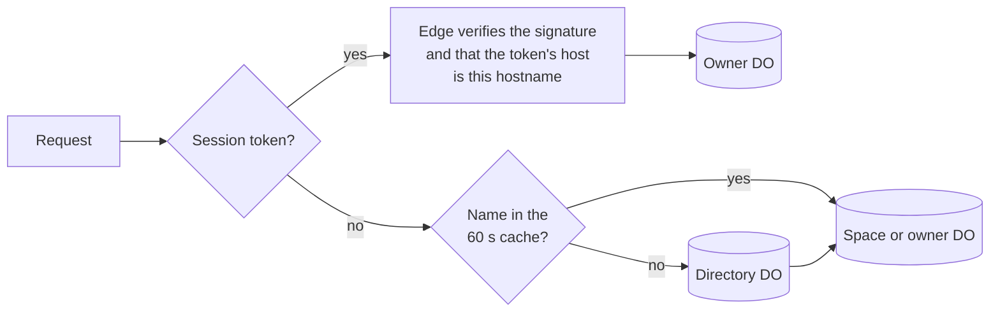

# 01 · Topology

Where every piece of state lives, which object serves each connection, and how
a request finds its object. Later files assume these placements.

## Durable Objects

The runtime is one Worker script that exports every class below and the edge
entry `[D 11-09]`. Operator services (mail, messengers, cloud instances, search,
plans) and the Inference Worker reach it through bindings with versioned
contracts `[D 11-09]`.

| Class | Named by | Holds | Serves connections from |
| --- | --- | --- | --- |
| Directory | `directory`, one object; split by name hash only if load ever needs it, by copying its one table `[D 11-12]` | Hostnames, handles, mail addresses and verified company domains → (space id, owner id, generation); signup provisioning operations `[D 11-11]`; keyed email hashes → handles, for a forgotten handle `[D 11-12]` | Nobody; the edge and services read it for first contact by name |
| Space | the space id (opaque) `[D 11-10]` | People, teams, membership and roles, agent accounts, grants (source of truth), sign-in methods and credentials, recovery, space settings and policy, the plan's limits, lifecycle state, the mount table, the owner registry `[D 11-09]` | Sign-in requests only |
| Owner | the owner id `[D 11-11]` | Event log and subscriber cursors, due-work table, process table and the profile's long-lived agents, responsibilities, sources, conversation index and bindings, deliveries, channels and contacts, approvals, rules, settings, ledger, connections (MCP sessions, OAuth and own keys, sealed), the machine registry, usage meters, grant copies `[D 11-09]` | People's clients (control WebSocket) |
| Process | `<owner id>/<pid>`, pid a random UUID `[1.0]` | Records, runs, epochs, inbox, parked calls, state, trace spans, Lifecycle jobs; the projection of rules and live facts; the ticket cache `[D 11-11]` | Run output readers (SSE) |
| Volume | `<owner id>/<volume id>` `[NEW]` | File rows, revisions, folders, indexed sections with FTS5, links, upload sessions, the change feed `[D 11-09]` | Nobody directly; bytes go through the edge to the blob store |
| Target | `<owner id>/<target id>` `[D 11-11]` | The machine's public key, presence, session records, effect outcomes, TTY and screen sessions, output tails | gsvd, the extension, cloud instances; people and agents attaching to TTYs, screens and long sessions |

There is no Conversation DO: a conversation is an indexed folder in a Volume
`[D 11-10]`. There is no App DO and no facet storage: 2.0 has no app layer
`[D 11-12]`.

### Naming and the space link

Owner, Process, Volume and Target DOs are named by the owner id, not the space,
so an owner can move between spaces on one deployment without copying bytes
`[D 11-11]`. Each holds a link to its current space with a generation number.
Every call into the DO carries the generation the caller resolved; a call with
an older generation fails with `moved`. A move updates the directory entry, the
two Space DOs and bumps the generation.

The Space DO is named by the space id. The directory is the only thing that
turns a public name into ids. Public callers never choose a space id, owner id
or pid `[1.0]`.

### Routing

`[D 11-12]`

- Signed-in traffic (sockets, the SDK, uploads, run output) routes by the token
  alone and never asks the directory. The token names the space, the person and
  the hostname it was issued for (see [02](02-identity-and-permissions.md)).
- Only first contact by name goes through the directory: sign-in pages, signup,
  Public links, hooks, inbound mail and contact lookups by handle. These are
  rare and cache for 60 s at the edge.
- One Directory DO is enough because of this. A single object also makes a
  signup's claims (handle, email key) one transaction, and operators list and
  search spaces with plain SQL.
- Cost: the object lives in one region, so an uncached lookup from far away
  pays one long round trip. Signed-in traffic never does.

## Stateless Workers

| Worker | Role |
| --- | --- |
| Edge (Gateway) | Routes signed-in requests by the session token alone `[D 11-12]`; resolves a hostname through the directory (60 s cache) only for first contact by name. Forwards the control WebSocket to the owner DO, run-output SSE to the Process DO, hooks to the owner DO. Holds no state. `[D 11-09]` |
| Upload | Takes 32 MiB parts with a ticket, streams each into the blob store while hashing it. A route in the same script. `[D 11-11]` |
| gsv shell | A Dynamic Worker loaded under one stable id per release. Its only binding is the calling process's gate, with identity pinned in props; its outbound fetch goes through the gate. `[D 11-11]` |
| CodeMode | A Dynamic Worker per script, `globalOutbound: null`, one syscall callback through the gate. `[1.0]` |
| Inference | Executes model requests with sealed keys, owns request ids, cancellation and reattach. Its own Worker, bound by contract. `[D 11-09]` |
| Operator services | Mail carriage, messenger adapters, cloud instances, web search, plans. Each has a `none` implementation. `[D 11-11]` |

## Connections

A connection lives with what it serves. Outside-world connections never sit in a
control object, with one decided exception: MCP sessions live in the owner DO
under strict limits (see [08](08-inference-and-quotas.md)) `[D 11-09]`.

| From | Lands on | Transport |
| --- | --- | --- |
| Web, Desktop, CLI | the owner DO they show (a person's own, or a team's console) | WebSocket, token in `Sec-WebSocket-Protocol` `[D 11-11]` |
| A run's live output | the Process DO | SSE from a cursor `[D 11-09]` |
| TTY, screen, long shell output | the Target DO | WebSocket with a ticket `[D 11-11]` |
| File bytes | the blob store through the edge | HTTP: Range GET, 32 MiB part PUTs `[D 11-11]` |
| gsvd, extension, cloud instances | their Target DO | WebSocket, upgrade signed by the machine key `[D 11-11]` |
| Messenger platforms | the adapter Worker, then the owner DO | Webhooks or the platform's gateway `[D 11-09]` |
| Inbound mail | the mail service, then the owner DO | Service binding `[D 11-12]` |
| Hooks (`/hooks/<id>`) | the owner DO that owns the source | HTTP `[D 11-09]` |
| Other owners (contacts, team work) | the recipient owner DO | DO-to-DO events `[D 11-11]` |

A team console connects with the person's own token to the team's owner DO; the
team DO admits it if its grant copies give that person read on the team
`[NEW]`.

## Ordering

Only the Space DO's own changes need one order across the space; its pushes
carry a sequence. Each owner and Target DO orders its own events. Across owners,
order per sender is enough `[D 11-09]`.

## Space lifecycle

Lifecycle state (`active`, `restricted`, `deleting`) lives in the Space DO,
which pushes every change to its owner DOs; nobody polls `[D 11-11]`. Only an
active space admits new work: sign-in, sockets, appends to owner logs,
inference, alarms and schedules fail closed in a restricted space. Work already
admitted reaches its next terminal boundary, and paused work rechecks when the
space is reactivated `[1.0]`.

## Invariants

- **TOP-1** A hostname the directory doesn't know gets a 404 from the edge and creates no DO state anywhere. `[1.0]`
- **TOP-2** Space ids, owner ids and pids come from the directory, a verified token or owned state, never from a request field. `[1.0]`
- **TOP-3** An owner-named DO refuses any call whose space-link generation is older than its own.
- **TOP-4** Owner and Process DOs are unreachable from Dynamic Workers. Scripts hold only a gate stub. `[D 11-10]`
- **TOP-5** No DO reads another owner's state. Owners interact only through events. `[D 11-11]`
- **TOP-6** A restricted space admits no new work and keeps all its data.
- **TOP-7** No file bytes are stored in a control DO. Small files may be cached in a Volume's SQLite (see [03](03-volumes.md)). `[D 11-09]`
- **TOP-8** A signed-in request never waits on the directory. `[D 11-12]`
- **TOP-9** A session token is accepted only on the hostname it was issued for. `[D 11-12]`

## Failure cases

| Case | Behaviour |
| --- | --- |
| The Directory DO is unavailable | Signed-in traffic is unaffected. Cached names keep routing for 60 s; uncached first contacts return `unavailable` (retryable) and signups wait. |
| The Space DO is unavailable | New sign-ins fail with `unavailable`. Existing sessions keep working on the owner DO's grant copies. Grant pushes retry until confirmed. |
| An owner DO restarts | Client sockets reconnect and resume from their cursors; due work resumes from its table. |
| A Process DO restarts mid-run | The run resumes; see [05](05-process.md) and [12](12-platform.md). |
| An owner moved to another space | Calls with the old generation, and tokens naming the old space, get `moved` at the owner DO; the SDK signs in again through the directory. |

## Tests

- Unknown hostname: the edge answers 404 and no DO beyond the directory is created.
- Directory down: signed-in sockets, SDK calls and uploads keep working; a cold sign-in page returns `unavailable`.
- A token issued for one hostname is refused on another, and a token with an edited space id fails its signature.
- Two concurrent signups for the same handle: exactly one succeeds.
- Space-link fence: bump a link generation, replay a call carrying the old one, expect `moved` and no state change.
- Source check: no Dynamic Worker bundle references an owner, Process, Volume or Target DO binding.
- Restricted space: every admission path (socket, append, inference, alarm, schedule) fails closed; an admitted run finishes its current step.
- Cross-owner: a lint finds no RPC from one owner DO that reads another owner's tables.
