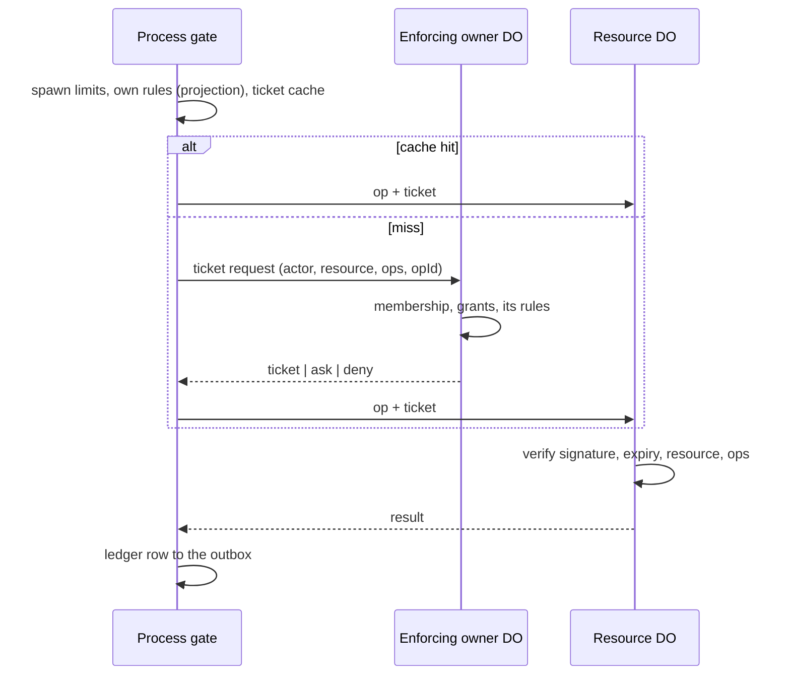

# 02 · Identity and permissions

Who can do what to which thing, how that is checked without a round trip per
operation, and how people sign in.

## The rule

Every action has an actor and a resource `[D 11-10]`. The actor's side decides
what it may attempt: its grant and its owner's rules. The resource owner's DO
decides what may be done to the resource: its grants and its rules. The DO that
holds the resource checks only a ticket. When the actor's owner and the
resource's owner differ, both apply (the two-owner rule) `[D 11-09]`.

## Actors

| Actor | Lives in | Identity proven by |
| --- | --- | --- |
| Person | Space DO | Session token (uid, space, epoch) `[D 11-10]`, plus the hostname it was issued for `[D 11-12]` |
| Team | Space DO | Acts only through its admins and members |
| Agent account | Space DO, owned by a person or team | Acts only through processes |
| Process | Its owner DO's process table | Identity passed as arguments between our own DOs `[D 11-10]` |
| Machine | Its owner's machine registry | Signature by the machine key, checked by its Target DO `[D 11-11]` |

Contacts, mail senders and hooks hold no grants. Their input arrives as events,
and what it can start is the owner's policy `[D 11-10]`. A person linked through
a messenger acts as themselves with a narrower messenger grant `[1.0]`.

Processes always run as an agent account. People act only through sessions
`[D 11-10]`.

## Resource kinds and verbs

Ten kinds, nine verbs `[D 11-11]`. The set is closed. A grant naming a verb its
kind lacks is rejected.

| Kind | Held in | Verbs |
| --- | --- | --- |
| space | Space DO | read, admin |
| account | Space DO | read, use (run processes as the agent), manage (create, rename, remove agents; a person's sign-in methods and tokens), share |
| owner | owner DO | read (settings, ledger, the reader's own view state), write (settings, rules), approve, share |
| files | Volume DO, enforced by the owner DO | read, write, share |
| machine | Target DO, enforced by the owner DO | read, write, use (commands, network, browser automation, TTYs, screen sessions), control (a person's live view, input and handoffs), manage (invite, rename, remove, start and stop cloud machines), share |
| process | Process DO, enforced by the owner DO | read, send, control (abort, reset, kill), share |
| responsibility | owner DO | read, write, share |
| source | owner DO | read, use (emit, run now), manage, share |
| channel | owner DO | read, send, manage, share (invites, acceptance, blocks, request decisions) |
| connection | owner DO | read, use, manage, share |

Listing is `read` on the owner's prefix; creating is `write` or `manage` on it.
Spawning a process is `use` on the agent account it runs as `[NEW]`.

Inference, the network and cloud-computer hours are quotas, not grants: every
process holds them, limited by its owner's quotas and rules
(see [08](08-inference-and-quotas.md)) `[D 11-11]`. Rules may name `infer` and
`net`; nobody grants them.

There is no `public` kind. Publishing is sharing with the Public grantee
`[D 11-11]`.

## Grants

A grant is subject + resource + operations `[D 11-10]`.

```ts
type Grant = {
  id: string;                 // also the share link id
  subject:
    | { person: OwnerId; peopleOnly?: true }
    | { agentsOf: OwnerId }
    | { team: OwnerId; role: "member" | "admin"; peopleOnly?: true }
    | { public: "link" | "listed" };
  resource: ResourceRef;      // kind + owner + selector (path prefix, machine id, channel id, ...)
  ops: Verb[];
  createdBy: ActorRef;
  createdAt: number;
};
```

- The Space DO holds every grant. It pushes each one to the DO that enforces it
  and to the subject's owner DO for listing, and retries until both confirm
  `[D 11-10]`.
- A grant to a person or team covers their agents unless it says people only
  `[D 11-10]`.
- Revocation: the Space DO pushes the removal; the enforcing DO stops renewing
  tickets, pushes revokes to the holders it recorded, and ends sessions opened
  under the grant. Grant copies carry a short expiry as a backstop `[D 11-09]`.
- Mode bits are a view: `ls -l` shows the owner plus `+` where grants exist
  `[D 11-10]`.

### Defaults

A person holds everything on their own tree and owner. Their agents hold the
same minus the people-only list `[D 11-11]`:

- `space.admin`
- `account.manage` on a person
- `owner.approve`
- `machine.control`
- `channel.share` for blocks and request decisions, and `channel.read` on incoming requests
- sharing the profile with Public

Admin roles never pass to agents `[D 11-10]`.

### Delegation

A child process gets at most its parent's grant: the same by default, narrower
if the parent says so at spawn (paths, operations), never wider `[D 11-10]`.

## Rules

An owner's rules say allow, ask or deny for a kind, verb and resource selector.
They never match syscall names `[D 11-11]`. Deny wins, then ask. "Always allow"
on an approval card writes a rule `[1.0]`.

The default asks, for agents only, editable per owner `[D 11-11]`:

1. `machine.write` or `machine.use` on an enrolled machine
2. `connection.use` on an MCP server
3. `channel.send` on a mailbox (sending mail)
4. `channel.send` to someone who isn't a contact
5. `source.manage` when the change makes a source start work (the gate computes this)
6. `share` on anything, including a write that changes something shared with Public

`gsv` and cloud computers are allowed by default `[D 11-11]`.

A rule names who answers: a person's rules ask that person; a team's rules ask
the acting member by default, or the team's admins, or a named person. The
approval is kept and answered in the owner DO whose rule asked, and its ledger
records the answer `[D 11-11]`.

Rules never leave their owner's DO. A person's rules are pushed into their
processes' projections and kept current. A team's rules are applied inside the
team's DO, and the ticket is the cached outcome. A DO only ever reads its own
owner's rules `[D 11-11]`.

## Tickets

The enforcing owner DO issues a ticket; the resource DO verifies it and nothing
else `[D 11-10]`.

```ts
type Ticket = {
  id: string;
  iss: OwnerId;                               // enforcing owner DO
  actor: { account: AccountId; pid?: Pid; run?: RunId };
  res: ResourceRef;
  ops: Verb[];
  opId?: OpId;                                // one-op tickets are single use
  exp: number;                                // cached tickets: 5 min
  decision: { rule?: RuleId; approval?: ApprovalId };
  sig: string;                                // HMAC-SHA256 with K
};
// K = HKDF(deployment secret, space id). One secret per deployment, also signing session tokens.
```

- Without an ask, a ticket lasts 5 minutes and the gate caches it. After an
  ask, the ticket covers that one operation and is single use `[D 11-11]`.
- An operation on two resources (copy, fork, a cloud start with a browser
  profile) needs one ticket per resource `[D 11-11]`.
- The issuer stores ticket ids per holder so a revocation can reach them.



A hit costs one RPC; a miss costs two. The actor's own owner DO is off the path
`[D 11-10]`.

When the enforcing DO's rule asks, that DO holds the approval and later sends
the decision plus a one-op ticket through the actor's owner log. When both the
actor's and the resource owner's rules ask, both approvals must pass; a deny
from either stops the operation; abort withdraws both `[D 11-11]`.

## Roles, teams and Public

- Admin and member, for the space and for each team. Space admins manage
  people, teams and space policy; team admins manage team grants and rules and
  answer team approvals. No custom roles: a team is the named group admins
  grant to `[D 11-10]`.
- No root account. Dangerous actions ask for a fresh sign-in. Reading another
  person's data takes an explicit self-grant, recorded in that person's
  Activity and notified to them `[D 11-10]` `[D 11-12]`.
- Each space has a built-in members team that owns `/`. In a family space
  members write `/`; in a company space admins do. It shows under the space's
  name ("Acme · all 42 people") `[D 11-11]`.
- The share sheet offers People and teams, Anyone with the link (unlisted), and
  Public (listed on the owner's public page). A link is the grant id:
  `<handle>.<domain>/s/<grant id>`. Public reads need no sign-in. Shared HTML and
  SVG are served with `Content-Security-Policy: sandbox` `[D 11-11]`.
- The owner's public profile is a file in their home shared with Public, opted
  into at setup `[D 11-11]`.

Teams in 2.0: the model, grants and the members team are built; team features
and the company release come later `[D 11-12]`.

## Sign-in

Checked in the Space DO `[D 11-10]`.

| Method | Notes |
| --- | --- |
| Passkey | Default after the first sign-in; synced passkeys on phones, QR from a laptop `[D 11-11]` |
| Google, Apple | OIDC through one shared callback that only relays the signed ID token; the Space DO checks the provider's signature and its own nonce; linked by the provider's account id, never by email `[D 11-10]` |
| Email code | Fallback and recovery `[D 11-10]` |
| Device code | CLI and Desktop, approved in the web UI `[D 11-10]` |

- A person may hold several methods. Adding one needs a fresh check with an
  existing one. The last method can't be removed `[D 11-11]`.
- A forgotten handle: on the deployment's own page a person enters an email
  address, and the directory mails that address the handles it signs in to.
  The page always answers the same way, so it reveals nothing about who has an
  account `[D 11-12]`. The directory stores only a keyed hash of each address
  (HMAC with a key from the deployment secret), written by the Space DO when an
  email-code method is added or removed `[NEW]`.
- No passwords `[D 11-10]`.
- Sign-in identities are unique per space, not across the deployment, so
  linking spaces stays possible later `[D 11-12]`.
- Logins saved by the CLI or Desktop are machine-bound: a proof-of-possession
  key in the Secure Enclave or TPM (a file key where neither is reachable) signs
  each upgrade `[D 11-11]`.
- People make only their own tokens; agents make none; machine credentials come
  only from device invitations; there are no service tokens `[D 11-11]`.
- Messenger pairing is people-only: the Ship may walk the person through it in
  chat, but a card naming the account behind the code completes only with a
  signed-in person's tap `[D 11-11]`.

Session tokens `[NEW]`: `{uid, space, host, epoch, exp}` signed with K, valid
12 hours; the SDK refreshes them from the sign-in session, which ends after 30
days without use. The owner DO checks the epoch against its copy of the grants
and closes the socket at expiry and on revocation `[D 11-11]`.

The edge only verifies a token, with no lookup `[D 11-12]`:

- K comes from the deployment secret and the token's space id, cached per
  space. An edited space id derives the wrong key and fails the signature.
- `host` must be the request's hostname, so a token from one space's host is
  refused on another's.
- A valid token routes straight to the person's owner DO. Revocation isn't
  checked at the edge; the owner DO checks the epoch, and the request goes
  there anyway.

Signup is `open` or `closed` per deployment. A new space comes from the signup
template in `gsv.config.ts`. Operators are the admins of the space named
`operatorSpace`; a fresh deployment's first space comes from a one-time setup
link printed by `gsv deploy` (single use, stored hashed, 24 hours) `[D 11-12]`.

## Invariants

- **AUTH-1** A resource DO accepts an operation only with a valid ticket for that resource and verb. A gate bug can't grant access. `[D 11-10]`
- **AUTH-2** No grant ever names an agent as holder of a people-only verb or an admin role.
- **AUTH-3** A child's effective grant is a subset of its parent's at every moment, including after the parent's grant shrinks.
- **AUTH-4** A revoked grant stops working within one ticket lifetime (5 min) even if every push is lost; with pushes, within seconds.
- **AUTH-5** An approval resumes an operation only if its run is still current. A cancelled or superseded run can't authorize anything. `[1.0]`
- **AUTH-6** Approval follows the actual destination, including calls made from inside scripts. `[1.0]`
- **AUTH-7** A DO reads only its own owner's rules.
- **AUTH-8** Sign-in methods never merge by matching email. `[1.0]`
- **AUTH-9** No credential, token, ticket or secret field appears in events, logs, traces or the ledger.

## Failure cases

| Case | Behaviour |
| --- | --- |
| Enforcing DO unreachable on a ticket miss | The call fails `unavailable` (retryable within the call deadline); cached tickets keep working until expiry. |
| Grant push lost | The Space DO retries until confirmed; the copy's expiry bounds staleness. |
| Ticket expired mid-operation | The resource DO finishes operations it already accepted; the next one needs a fresh ticket. |
| Approval answered after the run ended | The decision is recorded and does nothing else. |
| Shared link opened after unsharing | 404. |

## Latency budget `[NEW]`

| Path | p50 | p99 |
| --- | --- | --- |
| Gate check with a cached ticket | 1 ms | 5 ms |
| Ticket miss (one RPC to the enforcing DO) | 30 ms | 120 ms |
| Ticket verification in a resource DO | 0.2 ms | 1 ms |
| Sign-in in the Space DO, excluding the provider | 80 ms | 300 ms |

## Tests

- Port from 1.0: approvals follow the destination through native commands and CodeMode; a stale run can't authorize dispatch.
- Property test: for random grant sets and spawn narrowings, a child never acts beyond its parent.
- Revocation: revoke during a cached-ticket burst; no operation succeeds after expiry; with the push, none after the push lands.
- Two owners: alice's agent on a team machine with both rules asking; both cards appear, a deny from either blocks, abort withdraws both.
- People-only: every people-only verb refused for agent actors at the grant model, the gate and the enforcing DO.
- Ticket forgery: altered fields, wrong space key, replayed one-op ticket all refused.
- Sign-in: add-method needs a fresh check; last method can't be removed; Google account linked by subject, not email.
