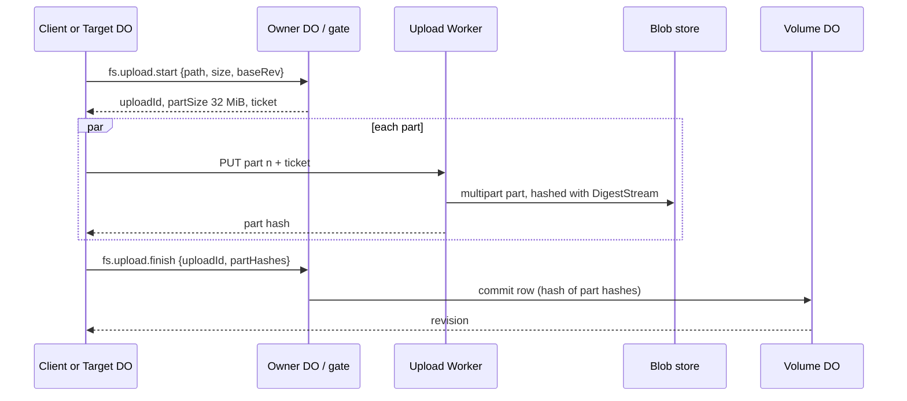

# 03 · Volumes

Files, folders, wikis, conversations and mail all live in Volumes: storage DOs
that keep file rows in SQLite while the bytes sit in the blob store by hash
`[D 11-09]`. Git is not part of GSV storage; real git stays on machines and
cloud computers `[D 11-09]`.

## Model

```sql
-- One Volume DO. Rows are inode-style: parent id + name, so a folder move is one row. [D 11-09]
files (
  id            TEXT PRIMARY KEY,
  parent_id     TEXT,             -- NULL for the volume root
  name          TEXT NOT NULL,
  kind          TEXT NOT NULL,    -- 'file' | 'folder'
  revision      INTEGER NOT NULL, -- current revision id
  indexed       INTEGER NOT NULL DEFAULT 0, -- folders only; inherited by children
  UNIQUE (parent_id, name)
);
revisions (
  rev           INTEGER PRIMARY KEY,   -- volume-wide, gap-free; the change feed cursor
  file_id       TEXT NOT NULL,
  folder_id     TEXT NOT NULL,          -- parent at the time, for the feed index
  op            TEXT NOT NULL,          -- 'write' | 'move' | 'delete' | 'restore'
  hash          TEXT,                   -- SHA-256 of the bytes (or of part hashes)
  size          INTEGER,
  inline        BLOB,                   -- small-file cache, see below
  blob_state    TEXT,                   -- 'inline' | 'both' | 'blob'
  author_uid    TEXT NOT NULL,
  author_pid    TEXT,
  base_rev      INTEGER,
  at            INTEGER NOT NULL,
  binned_until  INTEGER                 -- replaced or deleted: kept 30 days
);
CREATE INDEX revisions_feed ON revisions (folder_id, rev);
sections (file_id, rev, ordinal, heading_path, text);   -- indexed folders only
sections_fts USING fts5 (heading_path, text, content='sections'); -- bm25, headings x3
links (from_file, to_path);
uploads (id, path, base_rev, part_size, parts_json, expires_at);
```

The exact columns are `[NEW]`; the shapes (parent rows, revisions with author
and base revision, sections + external-content FTS5 + links, derived and
rebuildable) are `[D 11-09]`.

### Bytes

- Bytes are immutable, keyed `<owner id>/<sha256>` in the blob store, written
  before the row that names them commits `[D 11-09]`.
- Small-file cache `[D 11-10]`: a file under 16 KB is written into SQLite
  inside the commit and uploaded by a background Lifecycle job that retries.
  Once the blob store confirms and the file is cold (30 days since written), the
  job drops the SQLite copy. States only move forward: `inline → both → blob`.
  Reads take SQLite if present, else the blob store; a read never re-caches.
  Small files in indexed folders are never dropped, so a conversation's pages
  load from one SQLite query.
- Move and copy are rows, never bytes. Restore points a file at an old hash
  `[D 11-09]`. A move between owners copies the bytes once, since keys carry the
  owner `[D 11-09]`.

### Writes

- `fs.write` with a base revision fails with `conflict` if the file changed or
  moved `[D 11-09]`.
- Create-if-absent by name, for messages and dedupe `[D 11-10]`.
- `fs.batch` writes several files of one Volume in one transaction `[NEW]`.
- Every revision records the author's uid and pid `[D 11-09]`.

### The bin

Deleted files and the versions edits replace stay 30 days; the Ship or the
Files app can bring them back. Then a sweep job removes the rows and any hash no
row references. There is no version list or timeline `[D 11-09]`. Purge skips
the bin `[D 11-10]`.

### Indexed folders

A wiki is an indexed folder; turning indexing on is the whole `wiki` command
`[D 11-09]`. Text is split by heading into sections; FTS5 ranks with bm25 and
weights headings ×3; results are section-level, so no follow-up read is needed.
Search never touches the blob store. The model searches when it decides to;
there is no automatic recall `[D 11-09]`.

### Change feed

Every change takes the Volume's next revision number. `fs.changes {path,
after}` returns new, edited and deleted files in order plus a new cursor;
deletions are deletion revisions. While a client is connected the owner DO only
announces "now at M"; the client pulls with its ticket `[D 11-10]`. The same
feed drives client sync, owner-DO delivery of conversation messages, the
context projection for watched `context.d` and `skills.d` folders, and the
Files app.

## Layout

One seamless tree for the `gsv` computer `[D 11-09]`:

```text
/                 the space's shared drive, owned by the members team
/home/<name>/     a person's or agent account's home (one or more volumes)
/teams/<name>/    team folders
/home/<agent>/.gsv/processes/<pid>/   process.json, history/, epochs/, media/ (scratch)  [D 11-11]
/proc /sys /dev /etc/passwd           read-only views of DO state
/usr/share/manual, /sys/skills.d, /bin   shipped with the release, read-only
/tmp              per-process scratch, no history
```

- Homes, team folders and `/` are Volumes; mail and big imports get their own.
  A folder near the size cap splits by subfolder into a new Volume; paths never
  change, only the mount table `[D 11-09]`.
- The mount table lives in the Space DO; callers cache it and get pushes like
  grants. Volumes show only in `df` and `mount` `[D 11-09]`.
- Machines are separate targets, not mounts `[D 11-09]`.
- Release content (the profile's context, skills and Manual) is read-only, has
  reserved names, and is never copied into homes; people add files beside it
  `[D 11-12]`.

## Uploads and downloads

Requests carry at most 64 KiB of file bytes inline on the owner socket; larger
transfers use tickets over HTTP `[D 11-11]`.



- Fixed 32 MiB parts (the last smaller) keep the address deterministic: SHA-256
  of the bytes for one part, of the part hashes for more `[D 11-11]`.
- Failed parts retry alone; `fs.upload.status` says which parts landed;
  unfinished uploads are aborted after a day `[D 11-11]`.
- Machines write into folders the same way: their Target DO streams parts
  `[D 11-11]`.
- Downloads are Range GETs through the edge with a ticket. Shared links serve
  bytes with no sign-in, HTML and SVG under `Content-Security-Policy: sandbox`
  `[D 11-11]`.

## Limits

A Durable Object holds 10 GB. At the cap writes fail with `SQLITE_FULL` while
reads and deletes keep working. An indexed page costs about 1.9× its text, so
about 5 GB of indexed text fits in one Volume; a plain file with three
revisions about 364 B `[D 11-09]`. The realistic risk is a bulk import into one
indexed folder; imports are batched and watched for Volume CPU.

## Invariants

- **VOL-1** No row names a hash the blob store doesn't hold, except rows in the `inline` state, which hold the bytes themselves.
- **VOL-2** The sweep deletes a hash only when no live or binned row references it, and only after a delay longer than the longest upload-to-commit gap (1 day).
- **VOL-3** A write with a base revision never overwrites a newer revision.
- **VOL-4** A folder move or rename is one row update; history follows it.
- **VOL-5** The change feed is ordered and gap-free; resuming from cursor N returns exactly the revisions after N.
- **VOL-6** Sections and the FTS index match the current revision of every indexed file after each commit, and can be rebuilt from the blob store.
- **VOL-7** Search reads only SQLite.
- **VOL-8** A SQLite copy is dropped only after the blob store confirmed the same hash.
- **VOL-9** The Volume DO accepts an operation only with a ticket whose resource covers the path.

## Failure cases

| Case | Behaviour |
| --- | --- |
| Blob upload of a small file keeps failing | The row stays `inline`; reads serve SQLite; the job retries with backoff. |
| Volume reaches its size cap | Writes fail `storage_full`; reads and deletes work; a split job moves the largest subfolder to a new Volume. |
| Conflicting write | `conflict` with the current revision; the caller re-reads. |
| Upload interrupted | Resume from `fs.upload.status`; same parts, same address. |
| Crash after the blob write, before the commit | The bytes are unreferenced and the sweep removes them after its delay. |

## Latency budget `[NEW]`

| Path | p50 | p99 |
| --- | --- | --- |
| Small write, inside the Volume DO | 5 ms | 25 ms |
| Small read from SQLite, inside the Volume DO | 2 ms | 10 ms |
| Search over 4,000 pages | 2 ms | 15 ms |
| Change-feed page of 100 changes | 5 ms | 25 ms |

## Tests

- Folder move: one row changes; files keep their history; old paths 404.
- Bin: delete, restore within 30 days, sweep after; a hash referenced by a copy survives its original's sweep.
- Crash injection between blob write and commit, and between commit and blob upload of a small file.
- Small-file state machine: no transition backwards; a read never writes.
- Feed: random writes, moves and deletes; resuming from every cursor reproduces the same tail.
- Index rebuild from blobs equals the incremental index.
- Size cap: simulated `SQLITE_FULL` keeps reads and deletes working.
- Uploads: retried and reordered parts give the same address; abandoned uploads are aborted.
