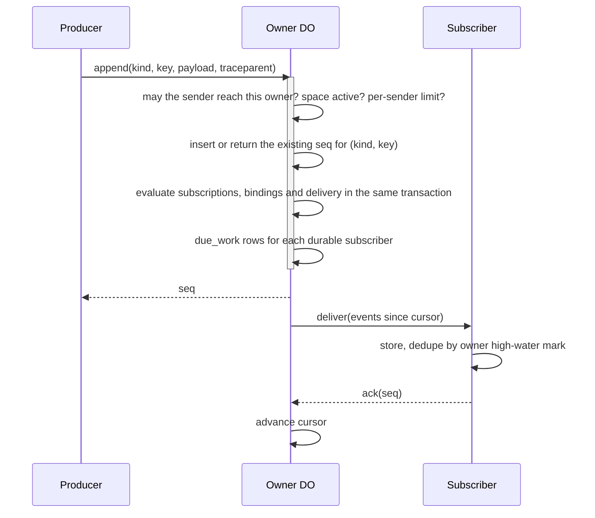

# 04 · Owner event log

Each owner DO keeps one log. Everything that can start or change work arrives
there as an event, and every consumer reads it from its own cursor
`[D 11-11]`. If missing something would be a bug, it is an event; refresh hints
are signals and are never stored `[D 11-11]`.

## Model

```sql
events (
  seq         INTEGER PRIMARY KEY,   -- gap-free per owner
  id          TEXT NOT NULL UNIQUE,  -- global event id, for cross-owner dedupe
  family      TEXT NOT NULL,         -- message | source | work | proc | approval | change | failure
  kind        TEXT NOT NULL,         -- one of the 32 kinds below
  key         TEXT NOT NULL,         -- from op ids and provider ids
  sender      TEXT NOT NULL,         -- set by the runtime, never by the payload
  payload     TEXT NOT NULL,         -- JSON, at most 64 KiB; larger content by file reference
  traceparent TEXT NOT NULL,         -- W3C trace context
  at          INTEGER NOT NULL,
  UNIQUE (kind, key)
);
subscribers (id, kind, target, cursor, state, stuck_since);  -- Process DOs, routes, other owners
due_work   (id, due_at, kind, ref, attempt, traceparent);    -- the one alarm per owner DO
ledger     (seq, actor_json, resource_json, resource_owner, op, decision_json, outcome, trace_id, at);
```

Column names are `[NEW]`; one log per owner with one cursor per subscriber,
keys from op ids, a due-work table with one alarm, and a separate ledger are
`[D 11-11]`.

## The 32 event kinds `[D 11-12]`

Names follow `<catalog kind>[.<type>].<past tense>`. Records use
created/updated/removed. A state change is `.updated` with the state in the
payload, and subscribers filter with `where`. The family is a field, not part
of the name. `conversation.*` is the one exception, since conversations are
folders rather than a catalog kind.

| Family | Kind | Key `[NEW]` | Payload `[NEW]` |
| --- | --- | --- | --- |
| message | `conversation.message` | message file id | conversation, message ref, author, addressed, origin surface |
| message | `channel.mail.received` | provider message id | mailbox, message folder, from, SPF/DKIM/DMARC result |
| message | `channel.request.received` | request id | channel, from, request ref |
| source | `source.schedule.due` | source id + due time | source, due time |
| source | `source.hook.received` | source id + delivery id | source, body ref |
| work | `responsibility.opened` | responsibility id | id, kind, conversation, brief ref |
| work | `responsibility.updated` | id + revision | id, status, changed fields |
| work | `responsibility.closed` | id | id, outcome |
| proc | `proc.message` | op id | from pid, to pid, text or ref |
| proc | `proc.call` | call id | from pid, to pid, deadline, input ref |
| proc | `proc.answer` | call id | call id, result or error |
| proc | `proc.history.archived` | pid + segment | pid, agent account, archive path |
| approval | `approval.asked` | approval id | actor, operation summary, rule, who answers |
| approval | `approval.decided` | approval id | decision, by, rule written |
| change | `machine.created` / `.updated` / `.removed` | machine id + revision | machine, status, screen available |
| change | `connection.created` / `.updated` / `.removed` | connection id + revision | connection, type, status |
| change | `channel.created` / `.updated` / `.removed` | channel id + revision | channel, type (mailbox, messenger, contact), status |
| change | `grant.created` / `.removed` | grant id | grant summary |
| change | `owner.settings.updated` | settings revision | changed keys |
| change | `owner.usage.updated` | meter + period + level | meter, level (80 or 100) |
| change | `conversation.opened` | conversation + person | conversation, person (once per person per conversation) |
| change | `files.changed` | volume + head | folder, head (only folders a process loads as context or skills) |
| failure | `delivery.failed` | delivery id | destination, reason, writer pid |
| failure | `proc.call.timed_out` | call id | call id |
| failure | `event.skipped` | subscriber + seq | subscriber, seq, reason |

Not events: UI refresh signals, the Space DO's state pushes, account changes
`[D 11-12]`. There is no notice family: notifications are delivery settings
over these events (see [06](06-conversations-and-delivery.md)) `[D 11-11]`.

## Append



- Producers: the person's socket, messengers, mail, other owners, schedules,
  hooks, machines, approvals, processes `[D 11-11]`.
- The append gate checks that the sender may reach this owner (contact policy,
  bindings, grants), that the space is active (pushed by the Space DO, never
  polled), and per-sender limits `[D 11-11]`.
- The same transaction evaluates the profile's responsibility kinds
  (see [13](13-ship-profile.md)), conversation bindings and delivery choice. This
  is what lets onboarding open inside the admission of the person's first
  message, so the first reply already follows it `[D 11-12]`.
- An append with an existing (kind, key) returns the stored seq. Keys come from
  op ids (pid, run, call) and provider ids, so crash retries never duplicate
  `[D 11-11]`.

## Delivery

Subscribers and their cursors `[D 11-11]`:

| Subscriber | Durable | Notes |
| --- | --- | --- |
| Process DO | yes | Durable handoff: it acks once stored and orders its own queue; the log has no lanes. |
| Delivery (messenger, mail) | yes | Created per committed message by the delivery choice. |
| Another owner | yes | Cross-owner forwarding of the sender's events. |
| Client socket | no | Resumes from its cursor within the hot window or gets `reset` and refetches. |

- Running processes receive every event addressed to them. Idle or parked
  processes are woken only by events that start or resume work; ride-along
  changes (machines, connections, grants, settings) wait for the next work
  event and keep only the latest per key `[D 11-09]` `[D 11-11]`.
- Which process: a conversation's handler (the profile agent's current pid), a
  responsibility's `to` conversation's handler, the pid named in a `proc.*`
  event, or the pid waiting on an approval `[NEW]`.
- Process dedupe is a high-water mark per owner, not a window of ids
  `[D 11-11]`. Cross-owner dedupe is a high-water mark per sender `[D 11-11]`.
- A subscriber that refuses an event (poison) gets it skipped with an
  `event.skipped` failure event; later events keep flowing `[D 11-11]`.
- A person's messages are never dropped. A durable subscriber stuck for an hour
  notifies the person through their notification settings `[D 11-11]`.

### Retry schedules

| Path | Schedule |
| --- | --- |
| Owner DO → Process DO | 1 s doubling to 5 min, forever `[NEW]` |
| Owner DO → messenger or mail delivery | 10 ms, then 1, 2, 4, 8, 16, 30, 30, 30, 30 s; an ambiguous attempt is never retried; final failure → `delivery.failed` to the writer, no fallback `[D 11-12]` `[1.0]` |
| Owner DO → another owner | backoff up to 24 h, then `delivery.failed` to the sending process `[D 11-11]` |

All retries, schedules, IPC deadlines and check-ins, sealing and reconcile jobs
are rows in the owner DO's due-work table under one alarm `[D 11-11]`.

IPC answers are appended before the answering run ends, so a deploy can't lose
them `[D 11-11]`.

## Retention

Settled events stay hot 30 days, then seal into blob segments kept to 90 days.
An event is never sealed before every durable subscriber has acked it
`[D 11-11]`. Bodies over 64 KiB are file references; messages are references
into their conversation folder `[D 11-11]`.

## Activity and the ledger

`owner.event.list` is the Activity read: people see everything in their log;
agents see what was delivered to them `[D 11-11]`.

The ledger is separate from the event log `[D 11-09]`. Each gate writes rows
into its outbox and ships them to the actor's owner DO, which sequences them and
pushes them to watchers. A row is actor (person, agent account, pid, run, op
id), resource and its owner, decision and outcome `[D 11-09]`. When the
resource belongs to another owner, the actor's owner DO forwards a copy to that
owner after the call, never blocking it `[D 11-12]`. Rows keep arguments up to
16 KB; fields the catalog marks secret are never stored `[D 11-12]`. Rows are
kept 90 days `[D 11-11]`. Who may read another owner's Activity is in
[02](02-identity-and-permissions.md) `[D 11-12]`.

## Signals

A signal is `{feed, head}` on a socket: "this feed moved, pull if you care".
Signals carry no data and are never stored; a closed client reads fresh state
when it opens `[D 11-11]`.

## Invariants

- **LOG-1** `seq` is gap-free and increasing per owner.
- **LOG-2** A (kind, key) pair is appended at most once.
- **LOG-3** A person's message, once accepted, is never dropped or skipped.
- **LOG-4** No event is sealed or deleted before every durable subscriber acked it.
- **LOG-5** Delivery is at least once; processing is exactly once (subscriber dedupe by high-water mark).
- **LOG-6** Subscriptions, bindings and the delivery choice commit atomically with the append.
- **LOG-7** A poison event never blocks the events after it.
- **LOG-8** The sender field is set by the runtime; payload fields can't change it.
- **LOG-9** A restricted space accepts no append that starts work.

## Failure cases

| Case | Behaviour |
| --- | --- |
| Process DO unreachable | Its due-work row retries on the schedule; events accumulate behind its cursor. |
| Process DO refuses an event | `event.skipped`; the cursor moves past it. |
| Recipient owner refuses a forwarded event (sender not allowed) | `delivery.failed` to the sender's process at once. |
| Owner DO crashes mid-append | The transaction didn't commit; the producer retries with the same key. |
| Owner DO crashes after commit, before push | The due-work row redelivers on wake. |
| A client socket was away beyond the hot window | `reset`; the client refetches state. |

## Latency budget `[NEW]`

| Path | p50 | p99 |
| --- | --- | --- |
| Append inside the owner DO | 2 ms | 10 ms |
| Append to run started (event → Process admits → generation request sent) | 40 ms | 150 ms |
| Cross-owner forward | 40 ms | 150 ms |

1.0's warm chat median from send to run was 116–128 ms; 2.0 should beat it.

## Tests

- Crash injection at every step: before commit, after commit before push, after store before ack.
- Duplicate appends with the same key from concurrent producers return one seq.
- Poison event followed by normal events: the normal ones are processed.
- Per-sender order across owners under reordering and retries.
- Sealing never removes an unacked event.
- Onboarding opens inside the first message's admission (subscription in the append transaction).
- Restricted space refuses appends that start work.
