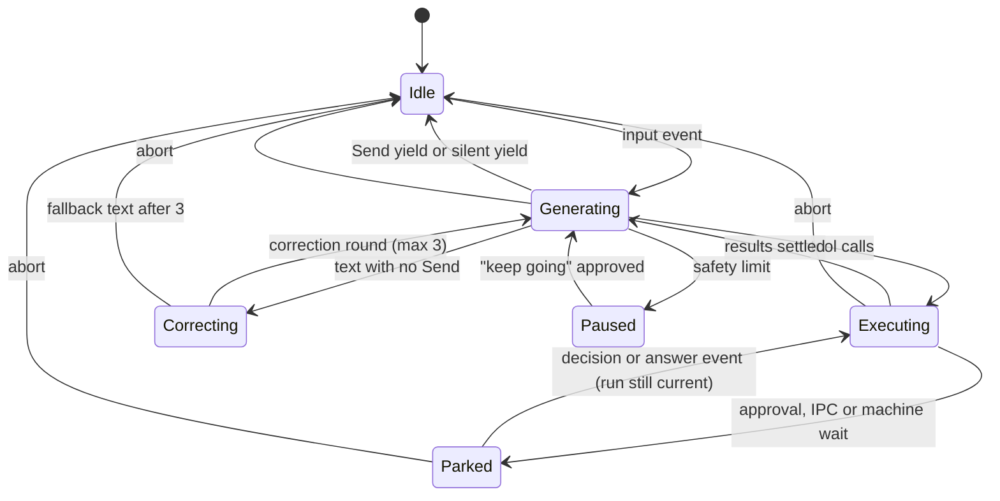

# 05 · Process

A process is a durable agent with its own Process DO. Its loop is ours, built
on the Agents SDK `Lifecycle` and capabilities, not on Pi or Think
`[D 11-09]`. Our loop holds the product semantics (epochs, Send and yield,
approvals that follow the destination, events, typed history); the SDK supplies
the plumbing: alarm and durable jobs, hibernating sockets, schedules, MCP
sessions and resumable streams.

## State

Seven tables plus the Lifecycle job table `[D 11-11]`:

| Table | Holds |
| --- | --- |
| `records` | The typed history: `(seq, rev, run, turn, epoch, kind, payload, media_refs, origin, audience, at)`; kinds message, note, call, result, event |
| `runs` | One row per run: id, trigger event, status, model calls, spend, started and ended |
| `epochs` | Exact rendered prompt, source manifest (the watch list), responsibility baseline, initial and last projection |
| `inbox` | Delivered events not yet consumed, with the owner high-water mark |
| `parked` | Tool calls waiting on approvals, machine sessions or IPC answers |
| `state` | Identity, grant and rules projection, ticket cache, settings, outbox |
| `traces` | Spans of the last 32 runs |

There is no prose column, legacy inference or compatibility block. 1.0 history
converts once at migration `[D 11-11]`.

## Context

The context is local: a frozen epoch plus a pushed projection, with no RPC
before a generation `[D 11-09]`.

An epoch freezes the exact system prompt, the manifest of sources it was built
from, and the initial responsibility baseline `[1.0]`. Sources:

| Source | Frozen or live | Arrives as |
| --- | --- | --- |
| Runtime context (`system/context.d`) | frozen | release content |
| Profile agent context (`ship/` or `crew/context.d`) | frozen | release content |
| The owner's `~/context.d` | frozen | `files.changed` |
| Skill catalog index (release and `~/skills.d`) | frozen | `files.changed` |
| Targets, ready MCP servers, date, timezone, language, address, mailbox | live | change events |
| Responsibilities | live after the baseline | `responsibility.*` events |

A change to a frozen source closes the epoch: it is archived with its prompt,
records and projection, and a new one opens before the next generation. A
change to a live fact appends a `context.changed` event record before the next
generation `[D 11-09]` `[1.0]`. There is no re-render per run and no pull of
responsibilities `[D 11-11]`.

Records render three ways from the same rows `[D 11-11]`:

| Renderer | Audience | Shape |
| --- | --- | --- |
| Model | the provider | Provider messages, `[GSV EVENT]` lines, origin annotations; person-only records dropped; images hydrated within the budget |
| Client | people | Every kind including person-only, cards, no event prose, thumbnails |
| Summary | compaction | Typed JSONL, no person-only records, media as descriptions |

1.0's golden provider-context snapshots are the contract for the model renderer
`[D 11-11]`. The image budget (25 MiB per build `[1.0]`) is spent newest first
and only on records the model sees `[D 11-11]`.

## Runs



### Waking

The owner DO pushes `deliver(events since cursor)`; the Process DO stores them
in `inbox`, dedupes by the owner's high-water mark and acks `[D 11-09]`. Then:

- input (a message, a responsibility, an answer for a parked call) → start or
  resume a run;
- a live fact → update the projection;
- a control event (abort, reset, kill) → act.

A Lifecycle heartbeat job runs while generating or executing; a parked process
holds only its timeouts `[D 11-09]`.

### Input while running

A person's message cancels everything in flight: the generation, running
foreground tools and waiting approvals, recorded as cancelled. A new run starts
with everything that has arrived `[D 11-11]`. In a crowd (a group or a shared
conversation) only messages addressed to the agent do this `[D 11-12]`.
Handed-off work (durable machine sessions, delegated children with a
responsibility) keeps its own contract.

Other inputs queue in order. The inbox holds at most 100 queued inputs; one
more produces `event.skipped` back to its sender `[D 11-11]`. A person's
messages never count against the limit, since each one cancels the run and
they are answered together `[NEW]`.

### Ending a run

A run started by a message ends with Send (with `yield`) or a silent `yield`
`[D 11-12]`. A model reply that is only text gets a correction round, at most
3, then the fallback "I wrote a reply but did not send it. Ask me again."
`[1.0]`. A process answering an IPC call has no Send; its final text is the
result `[1.0]`.

Per-run safety limits pause the run with an approval card ("keep going?") after
100 model calls, 2 hours or $1 in one run. The profile sets defaults; owners can
change them `[D 11-11]`.

## Tools

The model-facing tools are CodeMode, Send, Edit and Write `[D 11-11]`. Read,
Delete, Search and Shell are typed CodeMode functions named by catalog kind,
described by a `.d.ts` in the prompt.

```ts
// Send: run control and the user-visible message. Unchanged from 1.0. [D 11-12]
type Send = { text?: string; yield?: boolean; attach?: FileRef[]; choices?: Choice[] };

// CodeMode: one script, typed catalog functions, raw inputs beside the code. [D 11-11]
type CodeMode = { code: string; inputs?: Record<string, string> };
// inside: await fs.read({ path }), await shell.exec({ target, command }), await web.search({ q }) ...
// the return value is the result; console output streams to the run.

type Edit = { path: string; old: string; new: string; replaceAll?: boolean };
type Write = { path: string; content: string; baseRev?: number };
```

- A script calls syscalls only through its gate stub. Its file operations use
  call-scoped tickets limited to what the policy allows without asking
  `[D 11-09]`.
- A script blocked mid-way by an approval parks; on approval it re-runs with
  recorded results for the calls already made, so scripts must be
  deterministic (the runtime records `Date` and random values) `[D 11-11]`.
- Agents' tool calls retry transient errors inside the call deadline; the model
  sees the final error with `retryable` `[D 11-11]`.
- Sending somewhere other than the current conversation stays explicit:
  `channel.*.send` in CodeMode or `message send --to` in the shell, asking by
  default when it reaches people other than the owner `[D 11-12]`.

## The gate

The Process DO gates its own syscalls `[D 11-09]`:

```text
identity (pid, run, account) → spawn limits → own rules (projection) → ticket (cache or enforcing DO)
  → route to the serving DO → ledger row to the outbox
```

Approvals park the call, append `approval.asked` to the owner log (which shows
and notifies), and resume on `approval.decided` only if the run is still
current `[D 11-09]`. Spawn limits `[NEW]`: at most 16 live children per process
and a depth of 4.

## Abort, reset, kill

Every operation carries pid, run id, call id and op id; cancellation goes to
the component that owns the operation `[D 11-09]`.

| Command | Effect |
| --- | --- |
| `proc.abort` | Durable mark; cancel the inference stream and quick ops; withdraw parked approvals; handed-off work follows its own contract; late results are dropped by run id; input stays open `[D 11-09]` |
| `proc.reset` | Archive and clear history, keep the process `[1.0]` |
| `proc.kill` | The owner DO marks the pid terminal first, stops its tickets and routes, then tears the Process DO down (retried if unreachable) `[D 11-09]`. Kill cancels the dying process's durable machine sessions, kills plain helpers below it, and stops at children tied to a responsibility `[D 11-11]` |

A killed pid stays terminal and is never reused `[1.0]`. Replacing the Ship's
process is not death: the new pid inherits its children `[D 11-11]`.

## Recovery

Every run survives a Process DO reset `[D 11-11]`:

- an open model call reattaches by request id if the Inference Worker still
  holds it, else it is reissued (costs tokens, loses the partial stream);
- quick operations re-run only if marked safe in the catalog;
- remote starts (machine sessions, cloud starts, sends) are never replayed;
  they are polled or cancelled by op id.

## Compaction

Rules carried from 1.0 `[D 11-11]`:

- `proc.compact` stages a handover (at most 16,384 characters, one pending),
  installed after the round's tools settle and before the next generation.
- Automatic compaction at 0.9 of the context window brings it to 0.4.
  Emergency summarization covers all model-visible records in bounded passes of
  at most 4,096 tokens.
- Installation writes the archive file first, then one transaction: the event,
  the archived mark on the prefix, the epoch closed and opened.
- Fences on run, generation, epoch and projection stop a stale handover from
  installing.
- Compaction may archive completed steps within a run while keeping its input
  and unseen results. A worker's compaction never creates a memory review.

## Files

`~/.gsv/processes/<pid>/` in the run-as agent's home holds `process.json`,
`history/` (archived segments), `epochs/` (exact prompts) and `media/`
(scratch, deleted on reset and kill) `[D 11-11]`. Media are Volume references by
hash, so archiving copies nothing. `/proc/<pid>/` is the live view: status,
live records, links to the archives.

## Delegation and IPC

- `proc.send` with a call appends `proc.call` to the owner log; the deadline
  and check-ins are owner-DO due work; the answer is `proc.answer`; a child that
  dies produces a failure answer `[D 11-11]`.
- Ship's default delegation runs as the Crew account `[1.0]`, and Ship's
  delegations always record a responsibility `[D 11-11]`.
- A fork streams a range of records to the child over RPC (refs by hash); the
  child builds its own epoch `[D 11-11]`.
- Everything a process sends its owner DO (ledger rows, events, IPC answers)
  goes through one outbox, flushed once more at kill `[D 11-11]`.

## Memory review

When a compaction archives a segment of a profile agent's history, the owner
log gets `proc.history.archived`; the profile's `memory.review` responsibility
kind turns it into a responsibility, one at a time per owner
(see [13](13-ship-profile.md)) `[D 11-12]`. The Process keeps no pending list.

## Sync and live output

- History sync uses the cursor `(generation, rev)`; changed rows are re-sent;
  clients group by turn `[D 11-11]`.
- Live output (tokens, reasoning, Send drafts, tool progress, shell output the
  process receives) goes into a Streams log in the Process DO; clients read it
  over SSE from `Last-Event-ID` with a ticket `[D 11-09]`.

## Invariants

- **PROC-1** The provider history is structurally valid: every call has a result before the next generation. `[1.0]`
- **PROC-2** Accepted input is never lost; overflow produces `event.skipped`, never a silent drop. `[1.0]`
- **PROC-3** A stale or cancelled run never mutates active state; its late output is dropped by run id. `[1.0]`
- **PROC-4** A remote start is never replayed. `[1.0]`
- **PROC-5** A stale handover never installs. `[1.0]`
- **PROC-6** A killed pid is terminal across restarts and never reused. `[1.0]`
- **PROC-7** Every message-started run ends with Send-yield, silent yield, or the fallback after three corrections.
- **PROC-8** Between a wake and the generation request there is no RPC except to the Inference Worker.
- **PROC-9** The model receives exactly the epoch prompt plus the rendered records; the hash of the bytes sent is stored with the run.
- **PROC-10** New input, abort, reset and kill stay available while tools run. `[1.0]`
- **PROC-11** A child never outlives a killed parent unless a responsibility holds it.

## Failure cases

| Case | Behaviour |
| --- | --- |
| Inference Worker unreachable | The call retries within its deadline, then the run records the error and yields with a plain message. |
| Included AI exhausted | The run pauses with a notice; no silent fallback (see [08](08-inference-and-quotas.md)). |
| Approval never answered | The call stays parked; the run's timeout (default 24 h `[NEW]`) cancels it with a recorded result. |
| Child dies mid-call | The parent gets a failure answer. |
| Deploy resets the DO mid-tool | Open tool calls resolve by op id; nothing is replayed. |

## Latency budget `[NEW]`

| Path | p50 | p99 |
| --- | --- | --- |
| Wake → generation request sent (warm) | 15 ms | 60 ms |
| Gate overhead per syscall with a cached ticket | 2 ms | 10 ms |
| Tool result → next generation request | 10 ms | 40 ms |

## Tests

- Port 1.0's process invariant tests: provider history validity, queued input, pending-call consistency, stale-run fences, cancellation propagation, kill terminal across eviction, compaction fences.
- Port the golden provider-context snapshots as the model renderer's contract.
- Kill at every step of a run (Lifecycle reset injection) and check recovery rules.
- Interrupt: a message during generation, during a tool, during a parked approval.
- Inbox limit with mixed person and non-person inputs.
- CodeMode replay after approval produces the same calls with recorded `Date` and random values.
- Helpers: kill cascades to plain helpers, stops at responsibility-tied children, and the Ship's replacement inherits children.
