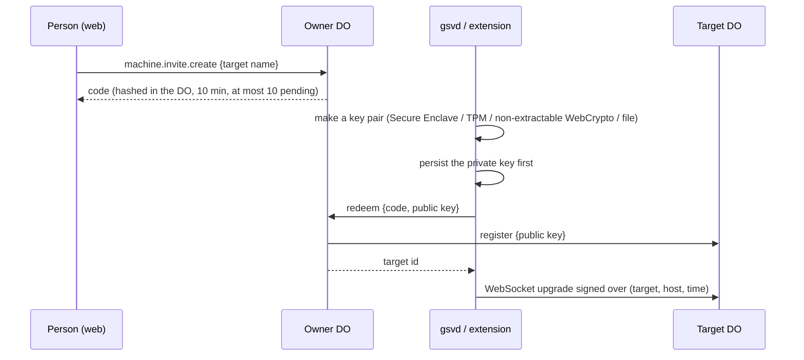

# 07 · Targets

A target is a Unix-shaped environment a process can act in `[1.0]`. Each
machine, extension browser, cloud computer and cloud browser has its own
Target DO named `<owner id>/<target id>` `[D 11-11]`.

`gsv` is not a Target DO. One resolver answers either "a machine runs it" (one
check on the machine) or "we run it" (each inner call checked by the gate).
There is one `gsv` per space: the shared tree with a home per owner, like a
multi-user Unix box `[D 11-11]`.

A targetable syscall keeps the same contract on every target `[1.0]`.

## Enrollment

- Keys replace 1.0's bearer machine tokens `[D 11-11]`. The edge forwards only
  ids it minted and MAC'd. Removing a machine deletes its key and closes its
  socket.
- The receiver persists its credential before redeeming; the owner DO commits
  the key and the redemption receipt atomically. Closing an invitation never
  revokes an already-paired machine `[1.0]`.

## The connection

- gsvd keeps 1.0's machine protocol: JSON `req`/`res`/`sig` frames plus binary
  body frames (4 MiB window, 1 MiB chunks, 64 streams) and `request.cancel`, on
  a new URL, with a signed hello that lists its live sessions `[D 11-11]`.
- The Target DO hibernates; pings are auto-answered without waking it; an alarm
  drops sockets whose auto-response timestamp went silent `[D 11-11]`.
- One socket and one key per machine. Desktop reaches its Target DO through
  gsvd's local channel, as the screen helper `[D 11-11]`.
- Presence: offline after a 30 s grace; changes append `machine.updated` with
  hostname, OS version and whether a screen is available `[D 11-11]`.

## Calls

- The Target DO checks the ticket and nothing else `[D 11-10]`.
- In-flight calls live in memory; there is no routing row `[D 11-11]`.
- Effects are recorded by op id before they are sent to the machine. The
  outcome is kept 1 hour; a repeat with the same op id gets the stored outcome
  or `outcome_unknown`. Reads are not recorded `[D 11-11]`.
- An offline machine fails fast with `target_offline`. There is no queue;
  coming back online is a `machine.updated` event `[D 11-11]`.
- Cancellation is an explicit `cancel(opId)` `[D 11-11]`.

## Long commands

- A recoverable start is `shell.exec` with `start: true` and a fresh
  `sessionId` the caller persisted first. The Target DO records the session
  before dispatch; the machine claims that exact id before spawning. Recovery
  only polls or cancels; it never replays a start or uncertain input `[1.0]`.
- The Target DO keeps the last 200,000 characters of output. Live output is a
  WebSocket attach with a ticket (`shell.attach`) `[D 11-11]`.
- Completion reaches the waiting process as `proc.answer` keyed by the
  session's op id, through the actor's owner log `[NEW]`.
- `shell.cancel` stops the session and its process tree; the machine owns the
  termination `[1.0]`.
- Sessions don't survive a gsvd restart. The hello lists the live ones; the
  rest are reported lost at once with their saved output. Updates drain sessions
  first `[D 11-11]`.

## TTYs

`[D 11-11]`

- gsvd opens a real PTY (Unix PTY, Windows ConPTY). The session lives in the
  Target DO; bytes flow both ways as binary frames, resize and signals as JSON;
  re-attaching replays the tail. Machines and cloud computers only; `gsv` stays
  line mode.
- People attach from the web and Desktop with xterm.js (`tty.attach`).
- Agents use the same sessions: `tty.open`, `tty.keys`, and
  `tty.screen({ waitFor })`, which returns the screen as text rendered by a
  terminal emulator in gsvd. One ask per session, an on-screen indicator, an
  idle end.

## Screens and computer use

`[D 11-11]`

- `screen.start`, `screen.capture`, `screen.input`, `screen.stop` are
  `machine.use`: one ask per screen session, an indicator, a stop button.
- A person's live view and input from another device (`screen.watch`,
  `screen.input` as a person) and handoffs are `machine.control`, which is
  people-only. The live-view format is 1.0's: JPEG screencast at quality 90 up
  to 1920×1200, newest frame only, at most 4 viewers, closed after 15 s idle
  `[1.0]`.
- The screen comes from Desktop through gsvd's local channel. Desktop hides
  its own windows and ignores input aimed at them.
- An agent driving the extension counts as a screen session.
- There is no fingerprint or passkey rule for approvals during a session; the
  risk that the agent clicks Approve is accepted `[D 11-11]`.

## Transfers

`[D 11-11]`

| From → to | Path |
| --- | --- |
| Device ↔ folder | 32 MiB parts and Range reads through the edge into the blob store |
| Machine ↔ folder | The Target DO streams parts into the blob store, or Range reads |
| Device ↔ machine | Parts and Range through the Target DO |
| Machine → machine | Source Target DO streams into the destination Target DO over RPC with end-to-end window credits |

Machine-to-machine: the destination writes `<name>.gsv-part` and reports its
offset; a retry with the same op id continues from it. The source checks size
and mtime (`conflict` if changed); both sides hash SHA-256 and compare, then
rename atomically. Both must be online. Blob bytes never pass through a DO;
machine bytes pass only through that machine's Target DO.

## Cloud computers and browsers

`[D 11-12]`

- C1: 1.0's shape. An optional service; cloud machines are targets; one
  immutable lease per boot, never replayed; destroy before releasing the
  reservation; lifetime reserved at start; browser and computer allowances are
  separate; off when self-hosted. The Target DO forwards to the instance
  service over RPC.
- C2: a browser profile's key is sealed in the owner DO and passed per start
  and save.
- C3: handoffs are approvals (`approval.asked`, `approval.decided`); the live
  lock stays in the instance service; state changes are `machine.updated`; there
  is no handoff link table or reconciler.
- Cloud computers and `gsv` are allowed without asking by default
  `[D 11-11]`.

## Team machines

A team's machine runs every command as one OS user, so members' agents can
read each other's files there. Confinement and per-member OS users are deferred
to 2.1 `[D 11-11]`.

## Invariants

- **TGT-1** A recorded effect is sent to the machine at most once per op id.
- **TGT-2** A start is never replayed after a restart of any component.
- **TGT-3** An offline target never queues work; the caller gets `target_offline` at once.
- **TGT-4** Blob bytes never pass through a Target DO; machine bytes pass only through their own.
- **TGT-5** A transfer is committed at the destination only after both hashes match.
- **TGT-6** Agents never hold `machine.control`.
- **TGT-7** A machine's private key never leaves the machine.

## Failure cases

| Case | Behaviour |
| --- | --- |
| Socket drops mid-call | In-flight calls fail `target_offline`; recorded effects answer `outcome_unknown` on repeat until the hello says otherwise. |
| gsvd restarts during a long session | The session is reported lost with its saved tail. |
| Transfer source changed during copy | `conflict`; the partial file is removed. |
| Cloud instance service unavailable | `unavailable` (retryable); no reservation is taken. |
| Target DO restarted | Sockets reconnect with the signed hello; outcomes survive in SQLite. |

## Latency budget `[NEW]`

| Path | p50 | p99 |
| --- | --- | --- |
| Gate → Target DO → machine → result, short command, same region | 60 ms + command | 250 ms + command |
| TTY keystroke round trip | 40 ms | 150 ms |
| Presence change → `machine.updated` appended | 31 s (grace) | 35 s |

## Tests

- Repeat an effect with the same op id across a Target DO restart: one execution.
- Offline machine: immediate `target_offline`, then `machine.updated` on reconnect.
- Kill gsvd during a long session: hello marks it lost; output tail preserved.
- Machine-to-machine copy interrupted and resumed with the same op id; source modified mid-copy gives `conflict`.
- TTY: re-attach replays the tail; `tty.screen({ waitFor })` returns after the text appears.
- Enrollment: replayed codes refused; removal closes the socket and the old key is refused.
