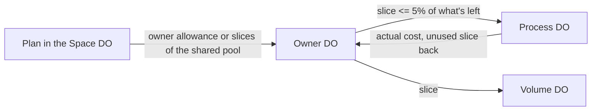

# 08 · Inference, connections and quotas

How a process reaches models and outside services, who pays, and how spending
is limited without a central counter on every call.

## Inference configuration

Three separate layers `[D 11-09]`:

| Layer | Where | Holds |
| --- | --- | --- |
| Policy | Space DO | Allowed providers and models, whether own keys are allowed |
| Choice | owner DO, then process | Named stacks per purpose (`chat`, `work`, `summarize`, `vision`, `speech`) within the policy; agent defaults from the profile (Ship fast, Crew stronger); a run may pick within its owner's stacks (`proc.settings`) |
| Payment | connections | Included (the operator's), the person's own keys, Codex |

- Agents may change their person's choices when asked; that is a feature
  `[D 11-09]`.
- A stack lists models in order. Failing over between providers of the same
  stack on errors is allowed `[1.0]`. Switching who pays is not: when the
  included allowance runs out, the run pauses (see below) `[D 11-11]`.

## The Inference Worker

- Keys are sealed so only the Inference Worker can open them. A request carries
  a reference to the sealed key, never the key `[D 11-09]`.
- The Worker owns request execution: request ids, streaming, cancellation
  (cancelling the returned stream or an explicit `cancel(requestId)`), reattach
  after a caller restart, and the actual cost of each request `[D 11-09]`
  `[D 11-11]`.
- The Process fences results by run id; a result for a run that is no longer
  current is dropped `[1.0]`.
- Inference through a person's machine (local models) goes through its Target
  DO `[D 11-09]`.

```ts
// Inference Worker contract (Workers RPC). Shapes are [NEW].
interface Inference {
  generate(req: {
    requestId: string;            // the op id; idempotent
    owner: OwnerId; pid: Pid; run: RunId;
    stack: StackRef;              // resolved model list + sealed key refs
    messages: ProviderMessage[];  // from the model renderer
    tools: ToolSchema[];
    traceparent: string;
  }): Promise<ReadableStream<InferenceChunk>>;
  reattach(requestId: string, fromChunk: number): Promise<ReadableStream<InferenceChunk> | null>;
  cancel(requestId: string): Promise<void>;
  cost(requestId: string): Promise<{ state: "running" | "done" | "unknown"; nanoUsd?: number; tokens?: TokenCounts }>;
}
```

## Connections

A connection is an outside service an owner holds credentials for: MCP
servers, OAuth accounts, saved browser profiles, own model keys and Codex, own
messenger bots `[D 11-10]` `[D 11-12]`. The runtime runs OAuth flows and seals
the tokens `[D 11-10]`.

MCP lives in the owner DO with 1.0's costs fixed `[D 11-09]`:

- session ids and tool lists stored in SQLite;
- rediscovered on failure or on a slow timer, never on wake;
- a timeout and a response-size cap on every call;
- streamable HTTP only (legacy SSE would hold a stream open and keep the DO awake).

Removing a connection wipes its credentials and revokes them at the provider
where the provider supports it `[D 11-11]`.

## Quotas

Grants say what you may touch; quotas say how much you may spend `[D 11-11]`.

### Meters

One mechanism with three shapes `[D 11-11]`:

| Shape | Meters |
| --- | --- |
| Allowance per UTC month or day | `ai` (money, included only), `search`, `net`, `mail.out`, `mail.in`, `cloud.browser`, `cloud.computer` |
| Level | `storage`, running cloud computers |
| Rate (token bucket, always returns `retryAfterMs`) | per-meter request rates |

Each spend counts on exactly one meter. A mail summary counts only as `ai`
`[D 11-11]`.

Storage counts live files plus the bin by logical size, including chats, mail
and process archives; operational records don't count. Over quota, uploads and
agent writes fail; incoming messages and mail still land `[D 11-11]`.

### Budgets in slices



- The plan lives in the Space DO; owner budgets in owner DOs; slices of at
  most about 5% of what is left go to Process and Volume DOs. Spend is counted
  where it happens and settled with the actual cost; after a restart the
  Process asks the Inference Worker by request id and never charges the maximum
  `[D 11-11]`.
- Overshoot is bounded by the slices outstanding. There is one counter per
  meter `[D 11-11]`.
- A family space uses one shared pool by default; the Space DO hands owner DOs
  slices of it the same way `[D 11-11]` `[NEW]` for the two-level slicing.
- A slice is refilled when half of it is used, off the call's path `[NEW]`.

### Own keys

Own keys never touch the included allowance. Their spend is counted for
display, with an optional monthly cap the person sets `[D 11-11]`.

### Running out

When the included AI runs out, the run pauses with a plain notice: when it
resets, and the choices (wait, use your own key, change plan). There is no
silent fallback; a setting may allow falling back to the person's own key
`[D 11-11]`.

Per-run safety limits are in [05](05-process.md) `[D 11-11]`.

### Seeing usage

- `owner.usage.updated` fires at 80% and 100% of each allowance; notifications
  follow the person's settings `[D 11-11]`.
- Settings has a Usage section in plain terms: percent of this month's AI,
  searches, storage, computer hours, per agent. `owner.usage.get` and `gsv usage`
  read it. Operators see money `[D 11-11]`.
- A space admin sees per-owner usage totals `[D 11-12]`.

### Plans

The plan comes from the operator's plan service, pushed to the Space DO and
kept up to 24 hours if the service is unreachable. Without a plan service
(self-hosting) there are no limits except the per-run safety limits
`[D 11-11]`.

### Errors

| Code | Retryable | Carries |
| --- | --- | --- |
| `quota_exhausted` | no | meter, `resetsAt` |
| `rate_limited` | yes | `retryAfterMs` |

`[D 11-11]`

## Invariants

- **INF-1** No key is readable outside the Inference Worker and the connection's sealed storage.
- **INF-2** Included spend never exceeds the plan by more than the sum of outstanding slices.
- **INF-3** Own-key spend never decrements an included allowance.
- **INF-4** A paused run never resumes on another payment source without the person's setting or choice.
- **INF-5** A request is charged its actual cost once, even across Process restarts.
- **INF-6** Every MCP call has a timeout and a response-size cap.

## Failure cases

| Case | Behaviour |
| --- | --- |
| Provider error | Fail over within the stack; if all fail, the run records the error and tells the person plainly. |
| Process restarts mid-generation | `reattach` from the last chunk, else reissue; cost settled by request id. |
| Plan service unreachable | Last plan kept 24 h, then the space falls back to the per-run safety limits only `[NEW]`. |
| Owner DO unreachable for a slice refill | The process continues on its current slice, then pauses with `unavailable`. |
| MCP server slow | The call times out at its limit; the session is marked for rediscovery. |

## Latency budget `[NEW]`

| Path | p50 | p99 |
| --- | --- | --- |
| Process → Inference Worker → provider request sent | 15 ms | 60 ms |
| Slice refill (off the call path) | 30 ms | 120 ms |
| MCP call overhead in the owner DO, excluding the server | 5 ms | 25 ms |

## Tests

- Concurrent processes spending one pool never overshoot more than the outstanding slices.
- Kill the Process mid-generation: the request is charged its actual cost once.
- Included exhausted with an own key present: the run pauses unless the fallback setting is on.
- `quota_exhausted` and `rate_limited` carry the right fields and retry semantics through the SDK.
- MCP: no rediscovery on wake; timeout and size cap enforced.
