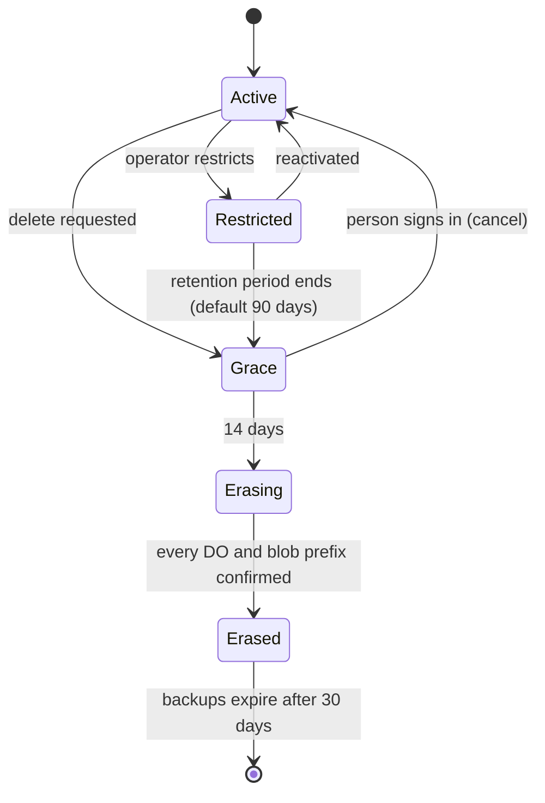

# 11 · Data lifecycle

How data is deleted, how long each kind of record is kept, how people take
everything out, and how an export comes back in `[D 11-11]`.

## Deletion

- The unit is an owner. Deleting a space deletes each owner, then the Space
  DO. Every DO is found from the owner's own registries (process table, the
  Volumes in the mount table, the machine registry) and blobs by the owner
  prefix; there are no inventory files `[D 11-11]`.
- Grace: 14 days, cancelled by signing in. Then live data is gone within a day,
  and backups age out 30 days later (DO point-in-time recovery). A receipt lists
  what can't be deleted (copies at model providers and messenger platforms) and
  when backups expire `[D 11-11]`.
- Erasure never waits on bookkeeping. The operator's declared outside copies
  (static deployment config) only feed the receipt `[D 11-11]`.
- A deleted owner's handle is held 12 months; owner ids never return. What
  someone sent to others stays with them `[D 11-11]`.
- There is no crypto-shredding in 2.0 (no security wins for now) `[D 11-09]`.



Erasure is a due-work job in the owner DO: it kills processes, empties each
Volume and Target DO, deletes the blob prefix, then the owner DO's own tables,
recording each step so a restart continues where it stopped `[NEW]`.

## Smaller removals

`[D 11-11]`

| Removed | What happens |
| --- | --- |
| Agent account | Its processes are killed, its home goes to the bin, its credentials are revoked |
| Machine | Its key is revoked, its Target DO emptied, gsvd forgets it |
| Connection | Credentials wiped, revoked at the provider where it supports that |
| A person leaving a space | They move out with their data, or are deleted after the grace |

## Restricted spaces

Kept for the operator's period (default 90 days), with notices at 30 and 7
days. Export stays open. Then the space is deleted `[D 11-11]`.

## Retention defaults

`[D 11-11]`

| Record | Kept |
| --- | --- |
| Files, conversations, mail | Until deleted (then the 30-day bin) |
| Process archives | 90 days |
| Event log | 30 days hot, sealed segments to 90 days |
| Ledger | 90 days |
| Traces | The last 32 runs per process |
| Inference requests | 24 hours |
| Usage totals | 13 months, no content |
| Target effect outcomes | 1 hour |
| Ended session tails | 7 days |

Owners can raise archive, log and ledger retention (for audits).

## Export

"Download everything" builds a zip of the owner's folders as they are plus
`gsv-export.json` (settings, contacts, sources, responsibilities, machines, 90
days of Activity). A job builds it into the blob store through the upload path;
the link is valid 7 days. Export is available while active, restricted and
during the grace `[D 11-11]`.

```ts
// gsv-export.json. Top-level keys [D 11-11]; the exact schema [NEW].
type GsvExport = {
  format: 1;
  exportId: string;
  owner: { id: OwnerId; handle: string; kind: "person" | "team" };
  createdAt: string;
  settings: OwnerSettings;
  rules: Rule[];
  agents: { name: string; home: string }[];
  contacts: { handle: string; alias?: string }[];
  sources: Source[];
  responsibilities: Responsibility[];
  machines: { name: string; platform: string }[];   // no keys
  activity: { events: string; ledger: string };     // paths to JSONL files inside the zip
};
```

## Import

An export zip imports into a new, empty owner on any deployment; setup offers
it `[D 11-11]`.

- Uses the upload path; idempotent by export id.
- Comes in: folders, conversations, settings and rules, agent accounts and
  homes, responsibilities, schedules, contacts as address entries.
- Stays out: secrets, live processes, the event log and the ledger (they come
  in as read-only files), machines (a re-link checklist).
- Nothing in the zip grants anything.
- The importer reads every `format` ever written.

## Invariants

- **LIFE-1** After erasure no DO named by the owner id holds rows and no blob exists under the owner prefix.
- **LIFE-2** Erasure resumes after any crash and never needs a human to unblock it.
- **LIFE-3** An owner id is never reused.
- **LIFE-4** An import never creates a grant, a credential or a running process.
- **LIFE-5** Export works in active, restricted and grace states.

## Failure cases

| Case | Behaviour |
| --- | --- |
| A Target DO's machine is offline during erasure | The Target DO is emptied anyway; gsvd forgets on its next connect attempt, which is refused. |
| Blob prefix deletion partially fails | The job retries the remaining keys. |
| Import interrupted | Restart with the same export id; finished parts are skipped. |
| Export larger than one part | Multipart through the upload path. |

## Tests

- Delete an owner with processes, volumes, machines and connections; verify LIFE-1 by listing every DO class and the blob prefix.
- Crash the erasure job at every step; it finishes.
- Grace cancel by sign-in restores everything.
- Export then import into a fresh deployment: folders, conversations, settings and contacts match; no grants or secrets came in.
