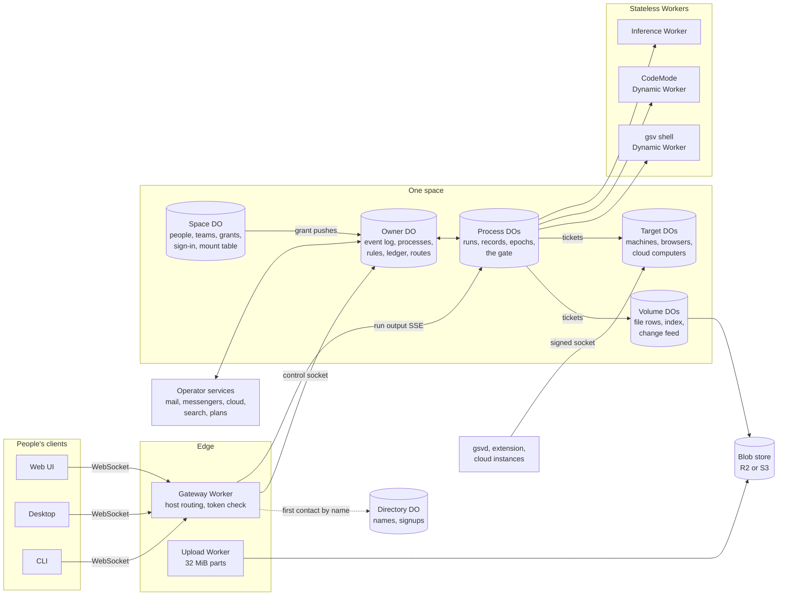

# GSV 2.0 build spec

This is the specification GSV 2.0 is built from. It collects the design
decided with the founder between 2026-11-06 and 2026-11-12 and turns it into
contracts, flows, invariants, failure cases, latency budgets and tests.

The 2.0 runtime is written from scratch. 1.0 stays in this repository
untouched; it is reference material and the source of the invariant tests we
port. Nothing here describes how 1.0 works today except where a line is marked
as carried from 1.0.

## Markers

Every rule carries where it came from, so a reviewer can tell a settled call
from something this write-up added.

| Marker | Meaning |
| --- | --- |
| `[D 11-10]` | Decided with the founder on that date (2026). Change only with the founder. |
| `[1.0]` | Behaviour carried over from 1.0 unchanged, by a decision to keep it. |
| `[NEW]` | Added while writing this spec to make a decided design buildable. Needs review. |

A section without a marker inherits the marker of its heading.

## Reading order

| # | File | What it settles |
| --- | --- | --- |
| 01 | [Topology](01-topology.md) | Every Durable Object and Worker, what each holds, how requests reach them |
| 02 | [Identity and permissions](02-identity-and-permissions.md) | Actors, resource kinds, verbs, grants, rules, tickets, sign-in, teams |
| 03 | [Volumes](03-volumes.md) | Files: rows, bytes by hash, indexed folders, change feeds, the bin, uploads, sharing |
| 04 | [Owner event log](04-owner-event-log.md) | The one log per owner, the 32 event kinds, subscribers, delivery, due work |
| 05 | [Process](05-process.md) | The agent loop on Lifecycle: runs, the gate, records, epochs, tools, delegation |
| 06 | [Conversations and delivery](06-conversations-and-delivery.md) | Conversations as folders, bindings, the follow choice, messengers, contacts, mail |
| 07 | [Targets](07-targets.md) | Machines, browsers, cloud computers, shells, TTYs, screens, transfers |
| 08 | [Inference and quotas](08-inference-and-quotas.md) | Model policy and choice, the Inference Worker, allowances, rates, safety limits |
| 09 | [Client protocol and SDK](09-client-protocol.md) | Frames, resume, watching, errors, retries, versioning, auth, the SDK |
| 10 | [Syscall catalog](10-syscall-catalog.md) | The 145 operations, naming rules, the authorization map |
| 11 | [Data lifecycle](11-data-lifecycle.md) | Deletion, retention, export, import, storage counting |
| 12 | [Platform](12-platform.md) | `gsv.config.ts`, workerd self-hosting, services, rolling updates, operators |
| 13 | [Ship profile](13-ship-profile.md) | The release's person profile: agents, conversations, responsibility kinds, content |
| 14 | [Observability and debugging](14-observability-and-debugging.md) | Traces, metrics, Activity, the run inspector, replay, `gsv dev` |
| 15 | [Build plan](15-build-plan.md) | Milestones, repository layout, latency budgets, test plan, the test deployment |
| 16 | [Deferred](16-deferred.md) | What 2.0 deliberately leaves out and where its design is recorded |

## The system on one page

Three rules shape every arrow `[D 11-09]`:

1. Control goes through the owner DO.
2. Work runs in Process DOs.
3. Data moves directly between the DO doing the work and the DO holding the
   data, carrying a ticket the owner DO's grants allow.

## Glossary

| Term | Meaning |
| --- | --- |
| Space | What people sign in to: one person, a household or a company. One Space DO. `[D 11-12]` |
| Owner | Who things belong to, who pays and decides: a person or a team. One owner DO each. `[D 11-09]` |
| Person | A human account in a space with an opaque, never-reused id. `[D 11-11]` |
| Team | People who own shared things together. Each space has a built-in members team. `[D 11-11]` |
| Agent account | A non-login account owned by a person or team. Acts only through processes. `[D 11-10]` |
| Process | A durable agent run-time with its own Process DO, always running as an agent account. `[D 11-10]` |
| Ship | The owner's agent and the handle it speaks from; also the product. The runtime has no Ship code. `[D 11-11]` |
| Crew | Ship's worker agent account for delegated work. `[1.0]` |
| Profile | The release's declarative description of a person's agents, conversations and responsibility kinds. Ship is the one profile. `[D 11-12]` |
| Volume | A storage DO holding file rows for part of the tree; bytes live in the blob store by hash. `[D 11-09]` |
| Target | A Unix-shaped environment a process can act in: a machine, a browser, a cloud computer, or `gsv` itself. `[1.0]` |
| `gsv` | The space's own computer: the shared file tree, its shell and network. Not a Target DO. `[D 11-11]` |
| Grant | Subject + resource + operations. The only permission model. `[D 11-10]` |
| Rule | An owner's allow / ask / deny policy over kind, operation and resource. `[D 11-10]` |
| Ticket | A signed, short-lived proof that an enforcing owner DO allowed an operation. `[D 11-10]` |
| Quota | How much an owner may spend: inference, network, mail, cloud hours, storage. Never a grant. `[D 11-11]` |
| Event | A stored row in an owner's log with a sequence number, replayable from a cursor. `[D 11-11]` |
| Signal | An ephemeral, data-free refresh hint on a socket. Never stored. `[D 11-11]` |
| Epoch | A frozen system prompt plus its source manifest, shared by the runs of one context generation. `[1.0]` |
| Record | One typed entry in a process history: message, note, call, result or event. `[D 11-11]` |
| Responsibility | A durable commitment (`r12y`) that must survive a run: promises, delegated work, follow-ups. `[1.0]` |
| Source | Something that emits events into an owner log: schedules, hooks. `[D 11-10]` |
| Channel | A way to reach people: mailbox, messenger account, contact. `[D 11-10]` |
| Connection | An outside service an owner holds credentials for: MCP server, OAuth account, browser profile, own model key. `[D 11-10]` |
| Conversation | An indexed folder whose files are messages. `[D 11-10]` |
| Binding | An inbound mapping from an external surface (a messenger DM, a group) to a conversation. `[D 11-12]` |
| Operator | Whoever runs a deployment; the admins of the space named `operatorSpace` in config. `[D 11-12]` |
